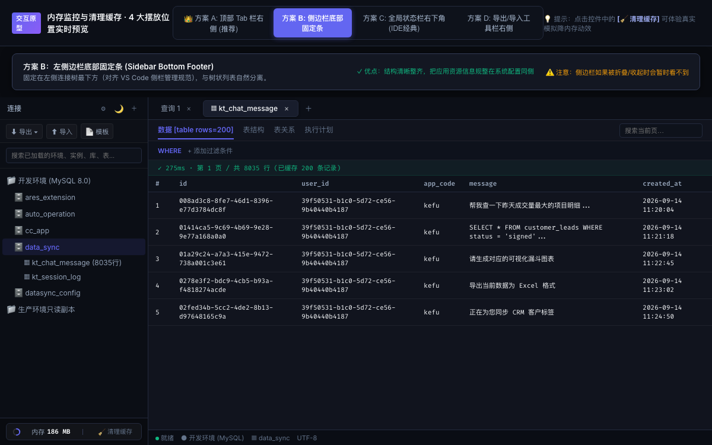

<div align="center">


# 智询 · ChatQuery

**现代、轻量、AI 原生的跨平台数据库工作台与智能协同中枢**  
*A lightweight, local-first, AI-native multi-model database client & MCP server for MySQL & Redis.*

<p align="center">
  <a href="README.md">English</a> •
  <a href="README_CN.md"><b>简体中文</b></a>
</p>

[](LICENSE)
[]()
[](https://www.rust-lang.org/)
[](https://tauri.app/)
[](https://react.dev/)

[功能特性](#-核心功能特性) •
[快速上手](#-快速安装与下载) •
[MCP 协同](#-mcp-server-智能体生态集成) •
[本地开发](#-本地源码开发与构建) •
[安全与隐私](#-隐私与安全设计) •
[文档](#-文档与技术规格)

</div>

---

## 📖 产品简介

**ChatQuery (智询)** 是一款为现代开发者、DBA 和数据分析师打造的**本地优先、AI 原生数据库客户端与管理工作台**。它摆脱了传统重量级数据库管理工具的高内存占用与陈旧交互，底层由高性能 **Rust** 引擎与 **Tauri v2** 驱动，前端采用专业级 **Monaco Editor (VS Code 内核)**。

不仅提供 MySQL 与 Redis 的高性能可视化查询与管理，智询更开创性地将**多智能体规划体系 (Multi-Agent)**、**SQL 安全护栏 (SQL Guard)**、**业务纠错动态记忆**以及 **MCP (Model Context Protocol)** 协议融为一体。

<div align="center">
  
</div>

---

## ⚡ 核心功能特性

### 1. 极致轻量与原生性能
- **超低资源占用**：基于 Rust + Tauri v2 构建，内存消耗相比传统 Electron 客户端降低 80% 以上，冷启动毫秒级响应。
- **现代化视觉交互**：深色/浅色自适应主题、平滑弹簧缓动动画、Finder 风格分层资源树、沉浸式多标签工作区。

### 2. MySQL 专业级管理与分析
- **智能查询编辑器**：集成 VS Code 原生 Monaco Editor 内核，提供智能感知（IntelliSense）、语法高亮、SQL 快速格式化与光标处单条执行。
- **单元格就地编辑与回写**：网格视图支持类似电子表格的原地编辑（INSERT / UPDATE / DELETE），基于主键进行原子性写回与事务保障。
- **可视执行计划 (EXPLAIN)**：一键诊断查询瓶颈、索引覆盖情况与全表扫描行数。
- **Mermaid 实体关系图 (ER Diagram)**：自动嗅探表外键关联与引用网络，支持缩放拖拽与矢量图导出。
- **外部工具配置导入**：支持一键解析导入 Navicat、DataGrip、DBeaver 的连接配置与 JDBC URL。

### 3. Redis 专精浏览器 (RDM 风格)
- **键空间分层树**：支持冒号分隔命名空间树形聚合，轻松组织海量 Key。
- **多类型数据支持**：全面支持 String、Hash、List、Set、ZSet 结构的原生展示与增删改。
- **PHP 反序列化查看器**：针对业界经典的 PHP 序列化缓存数据，内置一键解析反序列化为格式化 JSON。
- **TTL 动态维护**：直观展示过期倒计时，支持快速续期或设置为永久有效。

### 4. 深度 AI 智能体与自愈记忆
- **多模型供应商矩阵**：预设国内主流 Coding 订阅（MiniMax、智谱 GLM、DeepSeek、通义千问、Kimi、豆包等）与标准 API（OpenAI、Anthropic、Ollama 本地大模型、自定义端点）。
- **多 Agent 协同体系**：内置规划者（Planner）、探索者（Explorer）与执行者（Executor），全链路提供 Langfuse 架构的 Trace 可观测瀑布流。
- **SQL Guard 安全护栏**：内置三级操作策略（Allow / ConfirmRequired / Deny），严防无 WHERE 更新、DROP 库表等高危事故。
- **业务纠错记忆 (Memory Engine)**：AI 能够从对话中提炼业务常识与字段纠错记忆（例如「查询该业务表必须过滤 status=1」、「配置项使用 code 而非 key」），并在后续查询中全自动注入避坑。

### 5. 三位一体：GUI · CLI · MCP Server
- **GUI 桌面端**：面向日常开发的可视化交互窗口。
- **独立 CLI 命令行**：内置 `chatquery` 命令行工具，提供连接管理、只读查询、Redis 操作及环境树导出功能。
- **标准 MCP Server**：内置 Model Context Protocol (stdio 传输模式)，将本地数据库资产一键赋能给 Claude Desktop、Cursor、Windsurf、ZCode 等外部 AI IDE。

### 6. 端到端加密备份与跨机同步
- **AES-256-GCM + HKDF-SHA256**：所有连接密码、敏感配置均在本地加密存储，绝不回传云端。
- **Git 私有化同步**：支持端到端加密将连接配置、模型设定与代码片段备份至个人私有 Git 仓库，实现多设备安全漫游。

---

## 🚀 快速安装与下载

前往 [Releases 页面](https://github.com/miaow-growling/chatquery/releases) 或官方站点下载对应平台的最新安装包：

| 操作系统 | 架构类型 | 下载格式 | 说明 |
| :--- | :--- | :--- | :--- |
| **macOS** | Apple Silicon (M1/M2/M3/M4) | `.dmg` | 原生 arm64 极速运行 |
| **macOS** | Intel x64 | `.dmg` | 兼容旧款 Intel Mac |
| **Windows** | Windows 10/11 x64 | `.exe` (NSIS) | 标准向导安装包 |
| **Windows** | Windows 10/11 x64 | `.exe` (绿色版) | 免安装便携版，解压即用 |
| **Linux** | Ubuntu / Debian / x64 | `.AppImage` / `.deb` | 跨 Linux 发行版通用 |

---

## 🔌 MCP Server 智能体生态集成

ChatQuery 内置标准 **Model Context Protocol (MCP)** 服务，可让 Cursor、Claude Desktop 或其他外部 AI 助手安全、只读地感知和查询本地数据库。

### 在 Claude Desktop 或 Cursor 中配置：

编辑你的 MCP 配置文件（例如 `claude_desktop_config.json` 或 `.cursor/mcp.json`）：

```json
{
  "mcpServers": {
    "chatquery": {
      "command": "/Applications/智询.app/Contents/MacOS/chatquery",
      "args": ["mcp"]
    }
  }
}
```

*(Windows 环境下 `command` 填写 `chatquery.exe` 的绝对路径)*

### MCP 暴露的工具能力：
- `cq_list_topology`：获取已连接的数据库环境树与分类拓扑。
- `cq_get_prompt_context`：获取指定数据表的真实 Schema、字段注释与历史业务记忆规则。
- `cq_execute_query`：在指定数据源上执行带安全守卫的只读 SQL 查询。
- `cq_redis_get` / `cq_redis_keys`：读取 Redis 缓存键值并自动反序列化。
- `cq_add_memory` / `cq_list_memories`：探查与沉淀业务专有规则与字段口径。

---

## 🛠️ 本地源码开发与构建

### 前置环境要求
- **Rust** 1.78 或更高版本 (`rustup update stable`)
- **Node.js** 20.x 或更高版本 (`node -v`)
- **pnpm** 或 **npm**
- 系统构建依赖（仅 Linux 需安装 `libwebkit2gtk-4.1-dev` 等）

### 1. 克隆代码仓库
```bash
git clone git@github.com:miaow-growling/chatquery.git
cd chatquery
```

### 2. 安装前端依赖
```bash
cd frontend
npm install
cd ..
```

### 3. 运行本地开发环境
```bash
# 启动 Tauri 桌面端热重载开发模式
npm run dev
```

### 4. 运行 Rust 核心单元测试
```bash
cargo test --lib
```

### 5. 构建生产分发包
```bash
# 构建桌面安装包产物 (产物输出在 src-tauri/target/release/bundle)
npm run build
```

---

## 🔒 隐私与安全设计

1. **零数据上报**：ChatQuery 不设任何中转服务器收集用户数据库内容。所有的 SQL 执行、数据获取均直接在您的本地设备与目标数据库之间完成。
2. **两层加密模型 (Two-Layer Encryption)**：
   - 机器密钥 (KEK)：运行时动态生成，以 `0600` 权限安全保存在本地。
   - 密码凭据 (K)：通过 HKDF-SHA256 算法派生，对所有数据库连接密码及 LLM API Key 进行 AES-256-GCM 加密落盘。
3. **强制只读防护**：通过 MCP 开放给 AI 的数据库查询默认开启只读防御，主动阻断写入、更新与 DDL 语句，防止意外破坏。

---

## 📂 项目结构导览

```text
chatquery/
├── src/                    # Rust 核心库实现 (数据库驱动、LLM、MCP、安全策略)
│   ├── cli/                # 命令行 CLI 子命令与标准 Stdio MCP Server
│   ├── db/                 # MySQL 连接池、Redis 适配器、导入导出
│   ├── llm/                # Agent 编排、Langfuse Trace、安全护栏、记忆引擎
│   ├── crypto.rs           # AES-256-GCM + HKDF 双层加密
│   └── store/              # 本地 SQLite 元数据持久化
├── src-tauri/              # Tauri 桌面端包装层 (IPC 命令桥接、窗口管理、打包配置)
├── frontend/               # React 18 + TypeScript + Monaco Editor 前端
│   ├── src/
│   │   ├── components/     # Mermaid 关系图、数据助手、Trace 查看、记忆面板
│   │   ├── monaco-sql.ts   # VS Code 原生 Monaco Editor SQL 感知配置
│   │   └── App.tsx         # 桌面端主工作台视口
├── scripts/                # 构建打包辅助脚本与跨架构发布工具
├── website/                # 智询官方宣传主页与下载门户
└── docs/                   # 架构设计、安全说明与发布指南
```

---

## 📄 开源许可证

本项目基于 [MIT License](LICENSE) 许可证开源。欢迎提交 Issue 与 Pull Request 共同建设！
